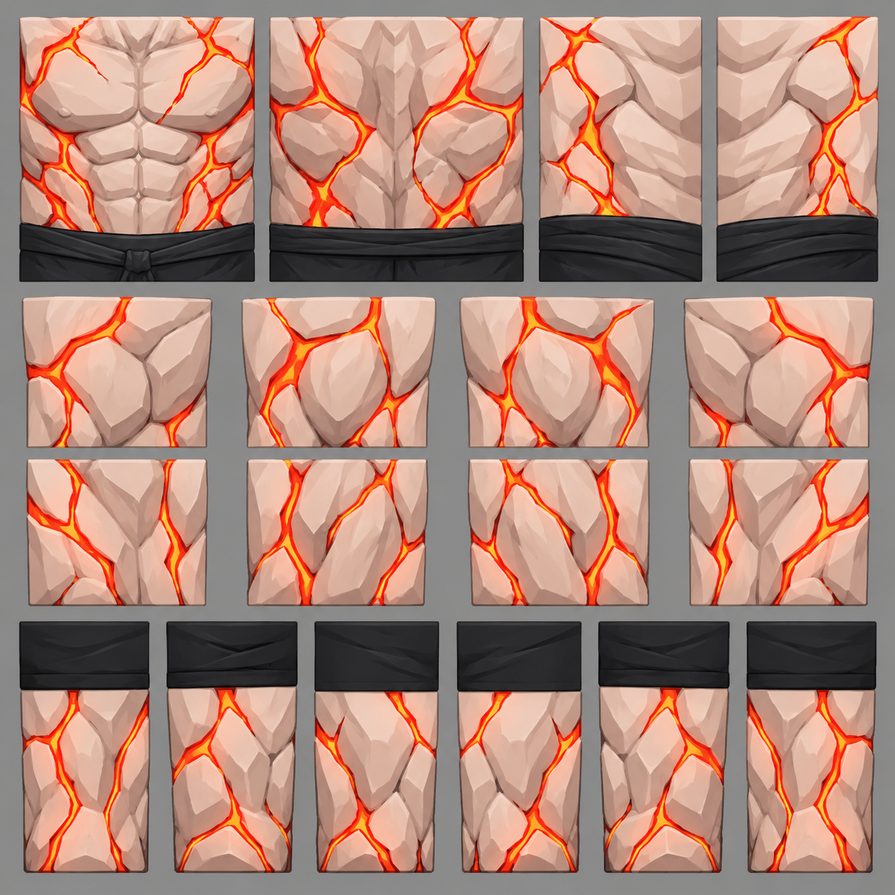
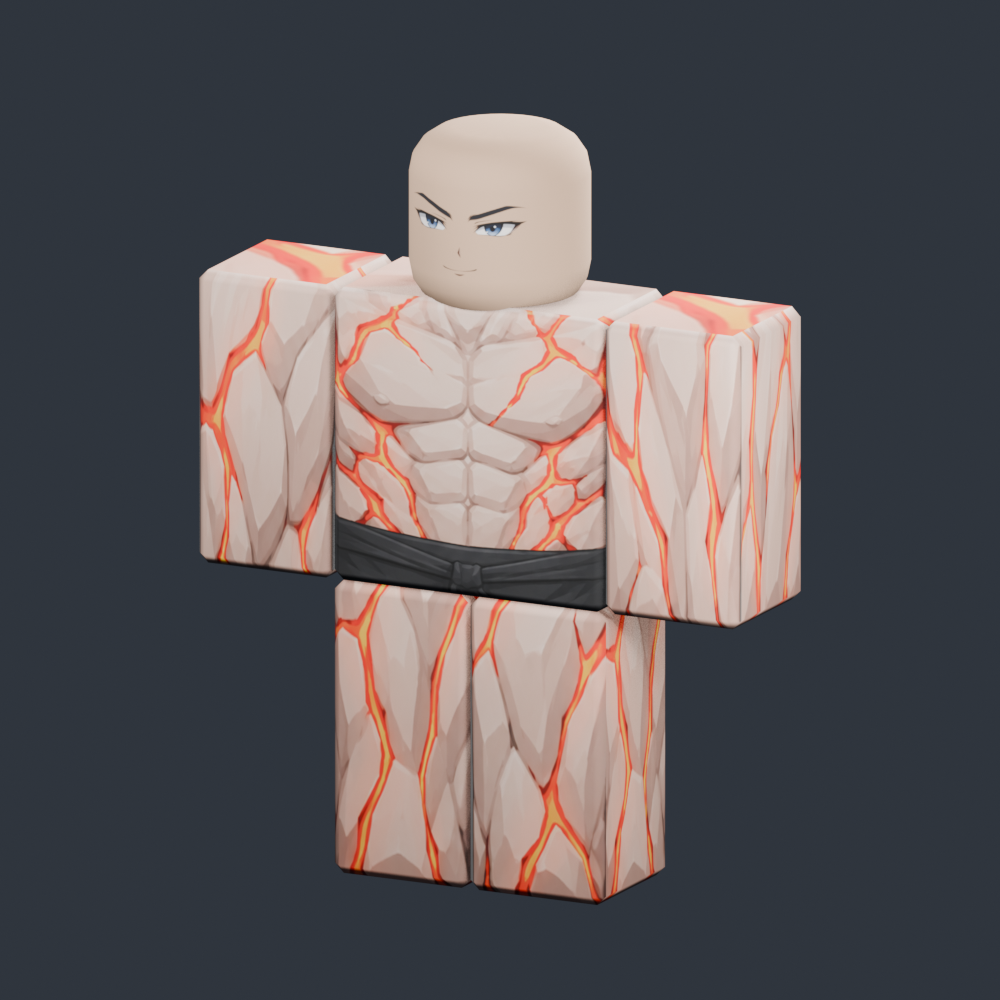
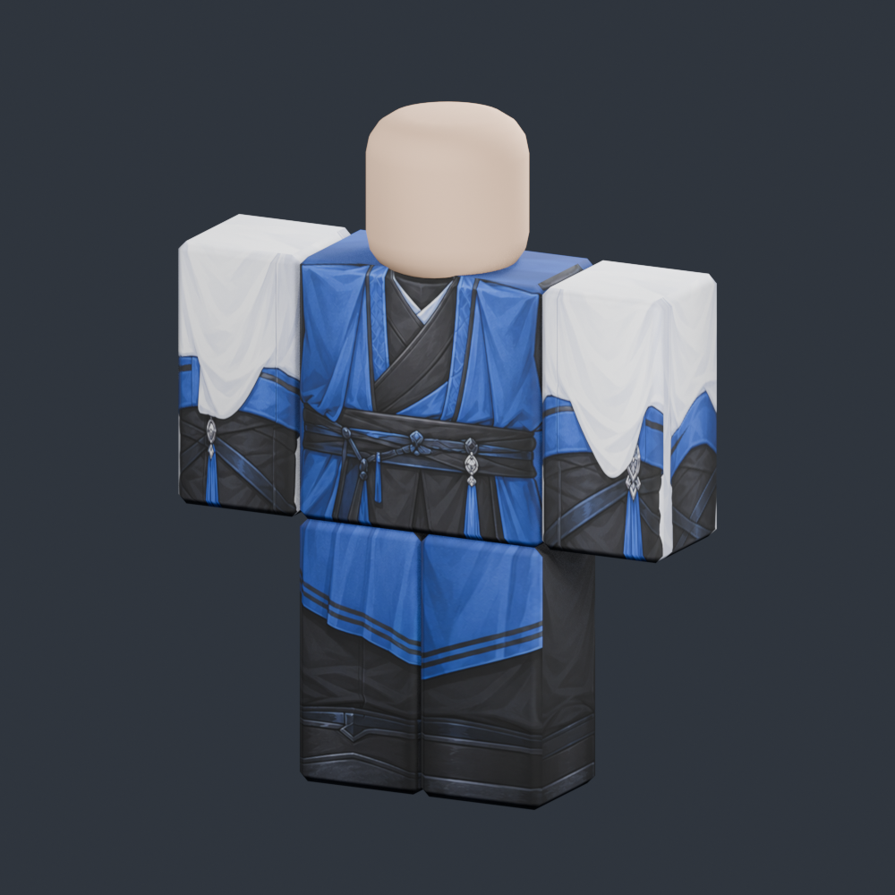
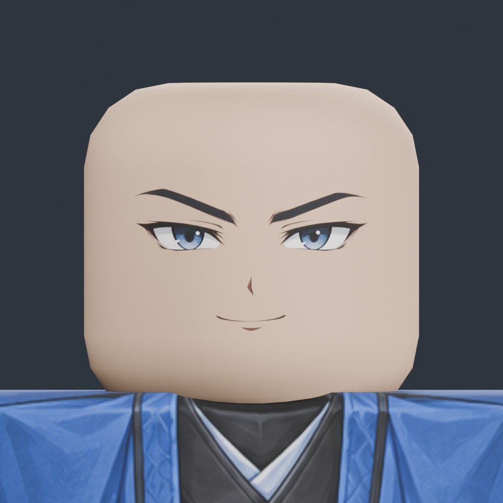

# Blender R6 Clothing & Face Painting

สกิลสำหรับช่วย AI เพ้นท์เสื้อผ้าและใบหน้าบนโมเดล **Roblox R6 ใน Blender** จากภาพอ้างอิงที่ผู้ใช้ส่งมา สกิลจะช่วยวิเคราะห์ลายชุด สร้างแผ่น Texture สำหรับชิ้นส่วน R6 แมป UV ตรวจผลบนโมเดล และเก็บ Texture ที่ทำแล้วไว้ใช้ซ้ำ

> สกิลนี้เป็นขั้นตอนการทำงานพร้อมสคริปต์และตัวอย่าง Texture ผู้ใช้ต้องมี Blender, การเชื่อมต่อ Blender MCP และโมเดล R6 ของตนเอง สกิลไม่ใช่โมเดลหรือปลั๊กอิน Blender ที่ทำงานได้ลำพัง

## ตัวอย่างจากงานจริง

### ภาพมอนสเตอร์ที่ผู้ใช้ส่งมา → Texture → R6

ภาพอ้างอิงเป็นมอนสเตอร์รูปร่างล่ำ ผิวสีซีด มีลายสีแดงตามลำตัว และกางเกงสีดำ ภาพต้นทางไม่มีส่วนหัว ตัวอย่างนี้จึงเพ้นท์ลำตัว แขน และขา ส่วนหัวใช้หน้าเดิมของโมเดล ลายแดงใน Texture ทดลองถูกตีความเป็นรอยหินเรืองแสง

| แผ่น Texture สำหรับ R6 | เมื่อนำไปแมปบนโมเดล R6 |
| --- | --- |
|  |  |

รูปต้นแบบที่ผู้ใช้ส่งในแชทไม่ได้อยู่ใน repository นี้ ภาพด้านบนเป็น **Texture ที่สร้างขึ้นและผลที่ตรวจใน Blender** ไม่ใช่ภาพต้นแบบเดิมหรือการจำลองรูปร่าง 3D ของมอนสเตอร์

### ชุดสีน้ำเงินขาวและใบหน้า

 

ชุดสีน้ำเงินขาวและหน้าอนิเมะตัวอย่างถูกเก็บเป็นไฟล์ PNG ใน `assets/` เพื่อใช้ซ้ำได้โดยไม่ต้องสร้างภาพใหม่

## ใช้งานอย่างไร

1. ติดตั้งโฟลเดอร์สกิลนี้ให้ระบบ AI ที่รองรับ Skills เห็นไฟล์ `SKILL.md` และไฟล์ประกอบทั้งหมด
2. เปิดโมเดล R6 ใน Blender และเชื่อม Blender MCP ให้ AI เข้าถึง Blender ได้
3. แนบภาพต้นแบบแล้วระบุว่าจะเพ้นท์ชุดและใบหน้าแบบใด
4. ตรวจภาพตัวอย่างหน้า หลัง และมุมเฉียงก่อนนำไฟล์ `.blend` หรือ PNG ไปใช้งานต่อ

ตัวอย่างคำสั่งเมื่อส่งภาพใหม่:

```text
ใช้ $blender-r6-clothing ทำ Texture ใหม่จากภาพที่แนบ ยึดสีและรายละเอียดในภาพเป็นหลัก
แมปลงบนโมเดล R6 ที่เปิดใน Blender ตรวจด้านหน้า ด้านหลัง และรอยต่อแขนขา
ส่วนที่ภาพมองไม่เห็นให้ออกแบบต่อให้เข้ากัน และคงใบหน้าเดิมไว้
```

ถ้าต้องการใบหน้า ให้เปลี่ยนประโยคสุดท้ายเป็น `ให้ออกแบบใบหน้าใหม่`, `ใช้ใบหน้าตามรูป`, หรือ `ใช้หน้าเดิมที่บันทึกไว้` ได้ การสั่ง `ชุดสีน้ำเงินขาวเดิม ไม่ต้องเจนใหม่` จะใช้ Texture ที่เก็บไว้โดยตรง

## ไฟล์สำคัญ

- `SKILL.md` — วิธีตัดสินใจและลำดับงานหลักของ AI
- `scripts/apply_cached_clothing.py` — ตรวจโมเดลและแมปชุดที่เก็บไว้ โดยไม่เปลี่ยนรูปทรงหรือ rig
- `assets/blue-robe-v1/` — Texture ชุด, manifest, ภาพตัวอย่าง และไฟล์ Blender ตัวอย่าง
- `assets/anime-face-v1/` — Texture ใบหน้าและภาพตัวอย่าง
- `references/` — หลัก UV, การตรวจคุณภาพ และพรอมต์สำหรับสร้างลายใหม่
- `examples/magma-creature/` — Texture และภาพผลจากการทดลองด้วยรูปมอนสเตอร์ที่ผู้ใช้ส่งมา

สคริปต์ชุดเดิมรองรับโมเดลที่มีชิ้นส่วน `Torso`, `Head`, `Left Arm`, `Right Arm`, `Left Leg`, `Right Leg` และแกนตรงกับตัวอย่าง หากเป็น R6 คนละโครงหรือภาพใหม่ AI ต้องตรวจขนาด ทิศทาง และวัดตำแหน่งแผ่น Texture ใหม่ก่อนแมป ไม่ควรนำค่าของชุดเดิมไปใช้กับภาพใหม่โดยตรง
